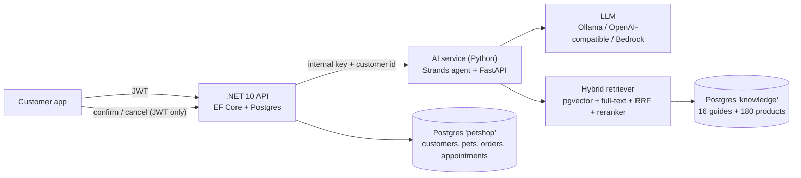

# PetShop AI

[](https://github.com/Franco-Rodriguez-Paciello/petshop-ai/actions/workflows/ci.yml)

A production-minded AI assistant for a pet store: a **.NET 10 API** that owns the business and the user identity, and a **Python agent service** (Strands Agents + FastAPI) with **hybrid RAG**, tool calling and **human-in-the-loop** for any action that changes data.

The goal of the project is not the chatbot itself but the engineering around it: authorization boundaries the model cannot cross, retrieval that is measured instead of assumed, and an evaluation set that includes prompt-injection attacks.

> The code, the domain and the knowledge base are in Spanish (the store serves Argentine customers). This README is in English.

## Highlights

- **The model never decides who the user is.** The .NET API authenticates the customer (JWT) and forwards the identity to the agent service; tools read it from the invocation state set by code, not from model arguments. This closes the classic IDOR where a user tells the LLM "I am someone else".
- **Human-in-the-loop by construction.** Tools can only *propose* a return or an appointment (a pending action). Confirming exists only as an endpoint for the customer's JWT, so neither internal services nor the LLM can execute it. Eligibility is re-validated at confirmation time.
- **Hybrid RAG, measured.** pgvector (HNSW) + Postgres full-text search in Spanish, fused with Reciprocal Rank Fusion and re-ranked with a multilingual cross-encoder. Every retrieval mode is benchmarked against a golden set (results below).
- **Verified citations.** A source is only returned if the model cited it *and* it was actually retrieved in that turn; invented citations are dropped.
- **Golden set of 89 cases** covering policies, pet care, health, products, account actions, appointments, prompt injection / impersonation and out-of-scope requests, with expected sources, expected tools, forbidden tools, expected backend state and an LLM-judge rubric.
- **Provider-agnostic model layer.** Ollama (local, default `gpt-oss:20b`), any OpenAI-compatible endpoint, or Amazon Bedrock, selected by configuration.

## Architecture



Each service owns its database: the API owns `petshop`, the AI service owns `knowledge` (RAG index).

| Endpoint group | Caller | Purpose |
|---|---|---|
| `/api/me/*` | Customer (JWT) | Orders, pets, appointments, pending actions, confirm/cancel |
| `/internal/*` | AI service / MCP server (shared key, constant-time check) | Same customer operations, **without** confirm/cancel |
| `/api/chat` | Customer (JWT) | Proxies to the agent and returns reply, sources and pending actions |

## Retrieval evaluation

60 golden-set questions with known sources, `k = 5`, local CPU reranker:

| Mode | hit@5 | recall@5 | MRR | p50 latency |
|---|---|---|---|---|
| Lexical (full-text) | 0.567 | 0.514 | 0.463 | 31 ms |
| Vector (bge-m3) | 0.933 | 0.908 | 0.837 | 61 ms |
| Hybrid (RRF) | 0.900 | 0.844 | 0.764 | 80 ms |
| **Hybrid + rerank** | **0.983** | **0.958** | **0.860** | 3,748 ms |

What the numbers say:

- **Plain hybrid is worse than vector-only here.** The lexical side is weak on conversational Spanish questions and RRF lets it push relevant chunks down. Hybrid only pays off once a cross-encoder re-ranks the fused candidates.
- **The reranker buys ~5 points of hit@5 at a 60x latency cost** on CPU. Next steps are running it on GPU, reducing the candidate pool, or using it only when the top results are close.

Run it yourself: `uv run --directory ai-service python ../evals/run_retrieval.py`

## Design decisions

- **Business rules live outside the LLM.** Return windows, slot availability and food recommendations are plain, unit-tested code; tools are thin adapters that turn domain errors into messages the model can relay.
- **Contextualized chunks.** One chunk per `##` section, with title and section prepended before embedding so short sections keep their topic.
- **Catalog chunks exclude price and stock.** Those change constantly and are fetched live through tools, so the index never serves stale prices.
- **Incremental ingestion.** Each chunk is hashed; re-ingestion only re-embeds what changed and deletes what disappeared.
- **Relative seed dates.** Demo orders are created relative to today so "within 30 days" scenarios keep working in demos and tests.

## Tech stack

**AI service:** Python 3.12, Strands Agents, FastAPI, Pydantic (structured output), Ollama, PostgreSQL + pgvector, fastembed (`bge-reranker-v2-m3`, ONNX int8), uv, pytest, ruff.
**Backend:** .NET 10, ASP.NET Core Minimal APIs, EF Core + Npgsql, JWT bearer auth, xUnit + Testcontainers.
**Infra:** Docker Compose, `pgvector/pgvector:pg17`.

## Repository layout

```
ai-service/   Python agent service: agent, tools, RAG (ingest, store, retriever), FastAPI app, tests
dotnet/       .NET 10 API: domain, EF Core, endpoints, AI service client, integration tests
data/         Knowledge base (markdown guides with front matter) and generated product catalog
evals/        Golden set and evaluation runners
infra/        Postgres init (creates the 'knowledge' database with pgvector)
```

## Running locally

Prerequisites: Docker, .NET 10 SDK, [uv](https://docs.astral.sh/uv/), [Ollama](https://ollama.com/).

```bash
# 1. Models
ollama pull gpt-oss:20b
ollama pull bge-m3

# 2. Postgres (pgvector) on localhost:5433
docker compose up -d postgres

# 3. AI service
cd ai-service
uv sync
uv run python -m petshop_ai.crear_db        # demo data for the agent's tools
uv run python -m petshop_ai.rag.ingest      # builds the RAG index (reranker model downloads on first query)
uv run uvicorn petshop_ai.api:app --port 8000

# Or chat from the console as customer C-001
uv run petshop-chat C-001

# 4. .NET API on http://localhost:5206 (OpenAPI at /openapi/v1.json)
cd dotnet/src/PetShop.Api
dotnet run
```

Demo login: `POST /api/auth/demo-login` with `{"email": "maria@example.com"}` (also `carlos@example.com`, `ana@example.com`). The demo login only asks for an email; a real deployment would use an identity provider such as Entra ID.

Tests:

```bash
cd ai-service && uv run pytest
cd dotnet && dotnet test     # integration tests need Docker running (Testcontainers)
```

## Status and roadmap

Done:

- [x] Agent service with tools, structured output, IDOR fix and human-in-the-loop
- [x] .NET API with JWT, internal endpoints, domain rules and integration tests
- [x] Hybrid RAG with reranking and verified citations
- [x] Golden set and retrieval evaluation
- [x] CI on GitHub Actions: Python lint + tests and .NET tests with a real Postgres (Testcontainers)

Next:

- [ ] End-to-end agent evals (tool selection, backend state, LLM judge) and run them in CI
- [ ] Point the agent's tools to the .NET `/internal` API through an **MCP server** (the agent still uses a small SQLite prototype database) and add the pets, appointments and food-recommendation tools
- [ ] Observability: OpenTelemetry traces per turn with tokens, cost and latency
- [ ] Containerize the AI service and deploy
